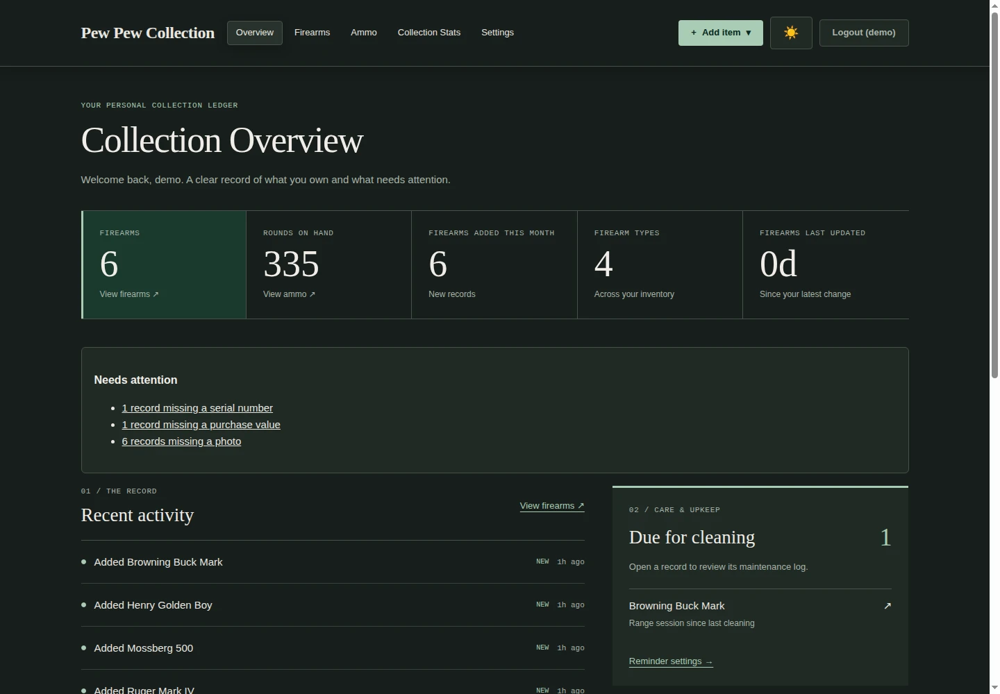

# Pew Pew Collection

Self-hosted, offline-first firearm and ammunition inventory app — track and manage a personal
collection locally with no cloud dependency. Node.js / Express + SQLite, no
build step, one Docker command to run.




[Tour the inventory, import history, and insurance report with screenshots](https://github.com/Gogorichielab/PPCollection/wiki/Screenshots).

## What it does

Use **Overview**, **Firearms**, **Ammo**, **Collection Stats**, and **Settings** to navigate.
Open **+ Add item** in the header and choose **Add firearm** or **Add ammo**. Use **Feedback** in the footer to open GitHub Issues.

- **Inventory CRUD** — add, edit, duplicate, and delete firearm records with
  make, model, serial, caliber, type, condition, status, location, purchase
  details, warranty, and notes
- **Disposition tracking** — records sold/lost/stolen items with transferee,
  date, and reason; included in CSV exports
- **Maintenance log** — per-firearm cleaning, repair, and part-replacement
  entries, with a configurable due-for-cleaning reminder
- **Range sessions** — per-firearm session log with date, location, rounds
  fired, and running totals
- **Photo attachments** — up to 12 photos per firearm, stored locally in the
  data volume (`/data/photos`)
- **Receipts & appraisals** — attach PDF receipts and appraisals (up to 5 MB
  each) in the **Receipts and appraisals** section of a firearm's page. Files
  are stored inside the SQLite database (`app.db`) and download only when you
  are signed in
- **Ammo inventory** — track manufacturer, caliber, grain, and load type with
  a boxes/rounds-per-box/loose-rounds breakdown, per-caliber totals, and a
  running count of rounds on hand, plus round-trippable CSV import and export.
  Editing a lot that changes its round count records the old and new totals,
  the time (UTC), and an optional reason in a **Quantity correction history**
  shown on the lot's edit page
- **Collection ledger dashboard** — separate firearm and ammunition totals, linked activity records, prominent cleaning
  reminders, exact type counts, and an expandable table of cumulative purchase costs. A **Needs attention** panel
  counts firearms missing a serial number, purchase value, or photo and links to the matching filtered list
- **Collection Stats** — type/caliber/make breakdowns,
  acquisition trends, average price by year, cleaning-due list, plus total ammunition rounds on hand and per-caliber links to the matching ammo lots.
  Every chart has a **View data table** toggle for screen readers and exact values
- **Insurance report** — preview the combined inventory from Collection Stats or Firearms, then choose which
  sections to include before printing: serial numbers, purchase values, and ammunition are on by default; storage
  locations are off. Untick serial numbers and locations before sharing a copy with anyone you would not
  give your safe's address and serials to.
  Tick individual receipts and appraisals under **Supporting PDFs**, then choose
  **Download report with selected PDFs** to save one self-contained HTML file
  that opens offline with the PDFs embedded
- **Search, filter, sort** — search both inventories from their respective tabs. Filters and sort order apply before pagination and stay in the URL. Ammo totals reflect the current selection.
  Open **Saved views** above either list to save the current search, filters, and sort under a name and reopen it with one click.
- **CSV import & export** — round-trippable for firearms and ammo, with a template. **Export CSV** downloads
  only the records matching the current search, filters, and sort, and the button shows how many records that is;
  clear the filters to export everything. Preview ammo lots, rounds, and invalid rows before importing. Reimporting a previously recorded file requires explicit confirmation. Import history starts when this version is installed.
- **Import history & undo** — choose **Import history** on either CSV import
  page to see past imports by file name, date, and record count. Open one to
  preview exactly which records an undo would remove. Records you have edited
  since, and firearms that now have photos, documents, maintenance, or range
  entries, are kept. Only imports made after upgrading to this version are tracked
- **Unsaved-changes guard** — leaving a firearm or ammo form with unsaved edits
  asks you to **Keep editing** or **Discard changes**
- **Single-admin auth** — bcrypt-hashed password, forced change on first
  login, CSRF on every form
- **Fully offline** — zero internet at runtime; the GitHub Releases update
  check is opt-in
- **One data directory** — the SQLite database and photo files live together
  under `/data`; back up that one directory with `cp`
- **Docker ready** — multi-arch image on GHCR

> **Privacy note:** a downloaded insurance report is an ordinary HTML file
> containing your inventory (serial numbers, locations, and values if you ticked
> them) plus any PDFs you selected. It is not password-protected — store and
> share it the way you would a scanned receipt.

## Quick start

```bash
docker run -d \
  --name ppcollection \
  -p 3000:3000 \
  -v /srv/ppcollection/data:/data \
  --restart unless-stopped \
  ghcr.io/gogorichielab/ppcollection:latest
```

No environment variables are required. To serve it somewhere other than port
3000, change the host side of the mapping only — `-p 3008:3000` — since the
image listens on 3000 inside the container. To finish setting up:

1. Open <http://localhost:3000>. It redirects to the setup page.
2. Get your one-time setup code from the container logs:

   ```bash
   docker logs ppcollection
   ```

3. Enter the code and choose your administrator username and password. You are
   signed in immediately, and the setup page is permanently disabled.

The setup code changes if the container restarts before you have finished, so
just read the logs again. Once an administrator exists no further code is ever
issued.

Your data lives in the mounted directory — the SQLite database at `app.db`
(inventory, attached receipt/appraisal PDFs, and signed-in sessions), firearm photos under `photos/`, and the
generated `session-secret` — so backing up that one directory backs up your whole
collection. Because sessions are stored there too, restarting or updating the
container keeps you signed in.

> The app generates its own session key on first start and refuses to fall back
> to a throwaway one, so the data directory must be writable by the container
> user (uid 1000). If startup fails with a message about persisting the session
> secret, run `chown -R 1000:1000 /srv/ppcollection/data`.
>
> `SESSION_SECRET`, `ADMIN_USERNAME`, and `ADMIN_PASSWORD` are still honoured as
> optional overrides for unattended installs. Setting `ADMIN_PASSWORD` seeds the
> account from the environment and skips the setup page entirely.

> Use an absolute host path for the volume (or a named volume like
> `-v ppcollection_data:/data`). Docker treats a bare `./data` as an
> anonymous volume and discards it whenever the container is recreated.
>
> **Important when updating:** reuse the exact same host directory or named
> volume every time you recreate the container. If the app shows you the setup
> page again after an update, it is almost always running against a new empty
> `/data` mount instead of your existing `app.db`. Stop the container and restore
> the previous mount before creating an account or adding new records.

### Docker update data check

If an updated container looks like a brand-new install — it shows the setup page
instead of your login — do **not** complete setup or add new inventory yet. That means the container is
not seeing the same SQLite file it used before the update. Check the active
mount and database file first:

```bash
docker inspect ppcollection --format '{{range .Mounts}}{{println .Source "->" .Destination}}{{end}}'
ls -lh ./data/app.db
```

For Docker Compose, run updates from the same directory that owns the original
`./data` folder, or change the compose file to an absolute bind mount such as
`/srv/ppcollection/data:/data`. For `docker run`, always reuse the same
absolute bind mount (`-v /srv/ppcollection/data:/data`) or the same named volume
(`-v ppcollection_data:/data`). Recreating the container without that mount
creates a fresh database at `/data/app.db`, which makes the app correctly behave
like a first-time install.

## Documentation

Full docs live in the [wiki](https://github.com/Gogorichielab/PPCollection/wiki):

- **[Installation](https://github.com/Gogorichielab/PPCollection/wiki/Installation)** — Docker, Docker Compose, and from-source setups
- **[Configuration](https://github.com/Gogorichielab/PPCollection/wiki/Configuration)** — every environment variable, with production defaults
- **[Security](https://github.com/Gogorichielab/PPCollection/wiki/Security)** — reverse-proxy setup, `TRUST_PROXY`, secure cookies, CSRF, audit logs
- **[Operations](https://github.com/Gogorichielab/PPCollection/wiki/Operations)** — health probe, graceful shutdown, backup and restore
- **[Upgrading](https://github.com/Gogorichielab/PPCollection/wiki/Upgrading)** — version-specific notes (v2.0.0 secure-cookies default, v2.0.1 session-secret guard)
- **[Architecture](https://github.com/Gogorichielab/PPCollection/wiki/Architecture)** — code layout and request lifecycle
- **[Screenshots](https://github.com/Gogorichielab/PPCollection/wiki/Screenshots)** — full gallery
- **[FAQ](https://github.com/Gogorichielab/PPCollection/wiki/FAQ)** — common questions and recovery procedures

## Verifying releases

Release images are scanned before publication, exercised through an end-to-end
login and inventory flow, and signed keylessly with Sigstore. Install
[cosign](https://docs.sigstore.dev/cosign/system_config/installation/) and verify
the image before deployment:

```bash
cosign verify ghcr.io/gogorichielab/ppcollection:latest \
  --certificate-identity-regexp 'https://github.com/Gogorichielab/PPCollection/.github/workflows/release.yml@.*' \
  --certificate-oidc-issuer https://token.actions.githubusercontent.com
```

Successful verification confirms that the image was signed by this repository's
release workflow. Pin a version tag or digest for reproducible deployments.

## Structured logs

Application-generated logs in production deployments, including the Docker
image, emit one JSON object per line to stdout or stderr. This works directly
with `docker logs`, journald, Loki, Vector, and other collectors. HTTP access
records use this schema:

| Field | Description |
| --- | --- |
| `ts` | ISO 8601 timestamp |
| `level` | `info`, `warn`, or `error` |
| `event` | Stable event name, such as `http.request` or `login.success` |
| `id` | Correlation ID shared by the response, access log, and related audit events |
| `method`, `url`, `status` | HTTP request and response details |
| `durationMs`, `contentLength` | Response timing and size when available |
| `remoteAddress`, `userAgent` | Request source metadata |

Clients may send an `X-Request-ID` header containing 1-128 letters, numbers,
periods, underscores, colons, or hyphens. Valid values are returned unchanged in
the response header; missing or invalid values are replaced with a UUID. Health
requests return a correlation header but are omitted from access logs to avoid
probe noise. Audit logs redact usernames and serial numbers unless
`AUDIT_VERBOSE=true`.

## Contributing

See [CONTRIBUTING.md](CONTRIBUTING.md) and the
[Contributing page](https://github.com/Gogorichielab/PPCollection/wiki/Contributing)
in the wiki. The project uses `.github/CODEOWNERS` to request maintainer
review automatically, especially for GitHub Actions, Docker runtime files,
release configuration, and database migrations.

## License

Licensed under the [Business Source License 1.1](LICENSE). Personal, non-commercial, self-hosted use is permitted at no charge. The license converts to Apache 2.0 on 2029-05-13.
