# Screenshots

Follow a sample collection from **Overview** through **Firearms**, **Ammo**, and **Collection Stats**.

## Overview

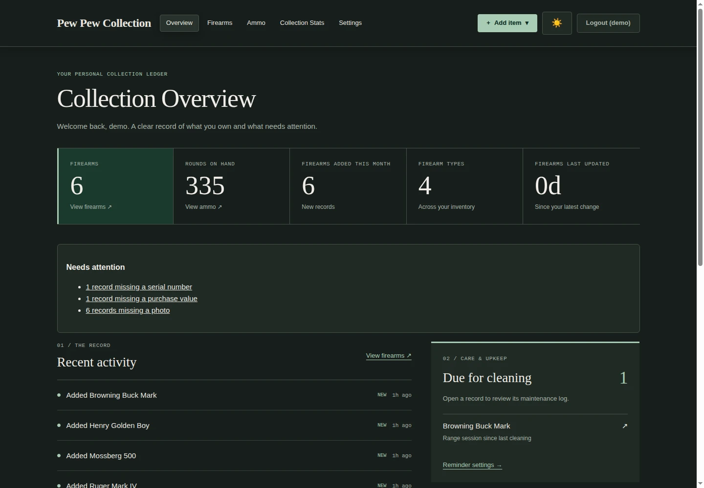

Select a count in **Needs attention** to find firearm records missing a serial number, purchase value, or photo. The firearm and ammunition totals link to their respective inventories.

## Firearms and saved views

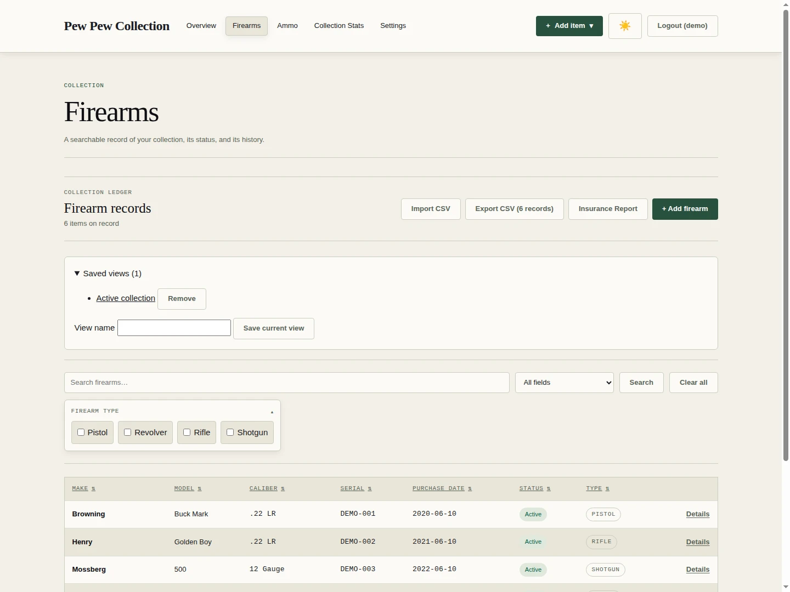

Set your search, filters, and sort order, open **Saved views**, enter a name, and choose **Save current view**. Select its name to reopen it later. **Export CSV** shows how many matching records you’ll get across all pages.

## Ammunition

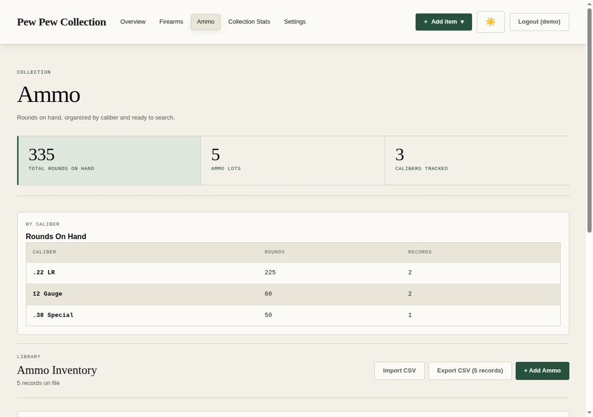

Use **+ Add item → Add ammo** to enter a lot. The Ammo list totals the rounds that match your filters. To correct a count, edit the lot and optionally enter a reason. The edit screen shows the previous and new totals and the UTC timestamp.

## Import history and undo

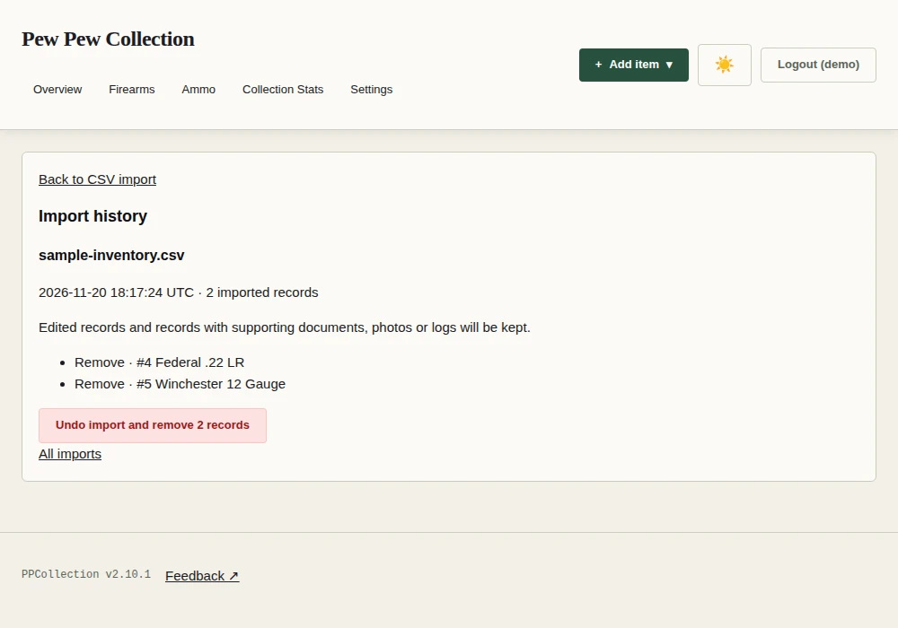

From either inventory choose **Import CSV → Import history**, then open a filename. Review the rows marked **Remove**, **Keep**, or **Absent** before selecting **Undo import**. Undo rechecks the rows and preserves edited records and firearms with related photos, documents, or logs. History covers imports made after tracking was introduced.

## Firearm detail

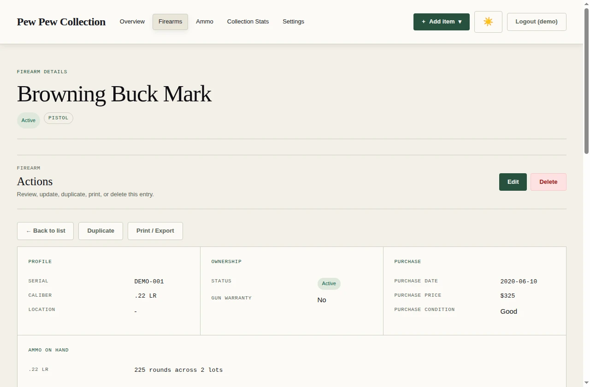

Grouped fields, edit / duplicate / delete actions, and disposition data when
applicable. Below the core record, the detail view shows the Maintenance Log,
Range Sessions, Photo Attachments, and Receipts and appraisals sections.

## Maintenance Log

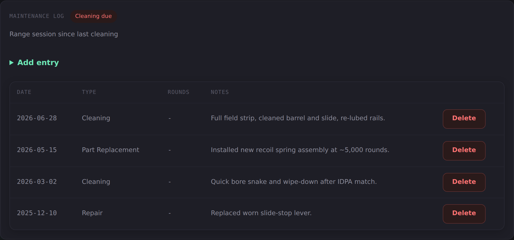

The **Maintenance Log** section on the firearm detail page lets you record
cleaning, repair, and part-replacement entries. Each entry captures a type,
date, and optional notes. A firearm is flagged as due for cleaning when its
most recent cleaning entry is older than the configurable threshold (default:
90 days), or when a range session is newer than the last cleaning. Overdue
firearms appear in the cleaning-due list on the dashboard, and the section
shows a **Cleaning due** badge with the reason.

## Range Sessions

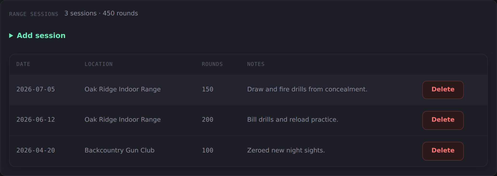

The **Range Sessions** section lets you log every trip to the range per
firearm — date, location, rounds fired, and notes. A running total of lifetime
rounds fired (and the session count) is displayed alongside the log.

## Photo Attachments

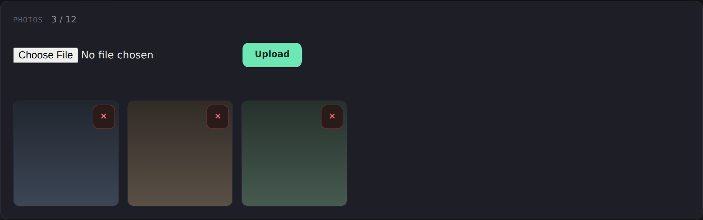

The **Photo Attachments** section lets you attach up to 12 photos per firearm
(JPEG, PNG, WebP, or GIF, up to 10 MB each). Images are stored on disk in the
data volume at `/data/photos` and served only to authenticated users through
an ownership-checked route. Deleting a firearm also removes its photos from
disk.

## Receipts and appraisals

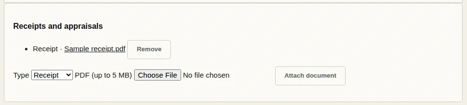

Open a firearm, scroll to **Receipts and appraisals**, choose a document type and a PDF up to 5 MB, then select **Attach document**. The filename links to the original PDF.

## Add firearm

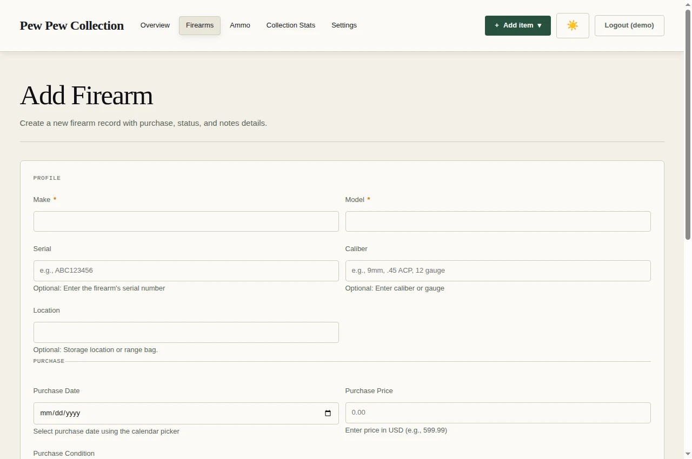

The same form is used for edit; status changes drive which disposition fields
are required. Choosing another in-app link after editing offers **Keep editing** or **Discard changes**.

## Collection Stats

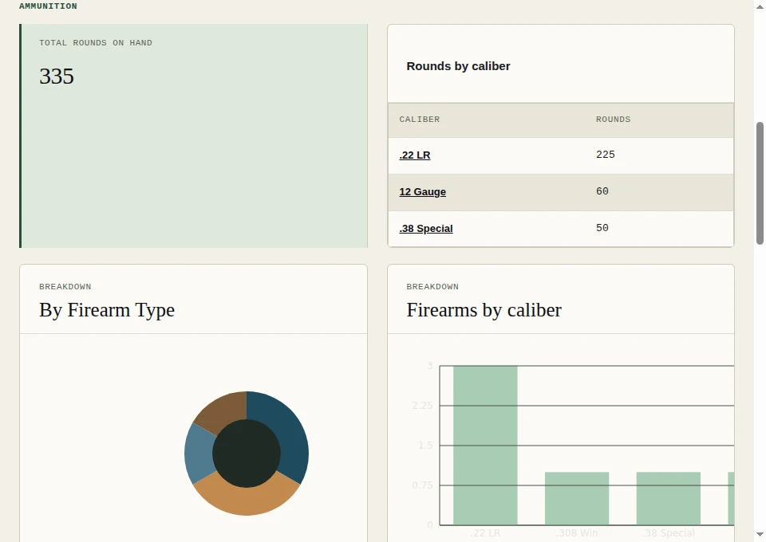

Select a caliber in **Rounds by caliber** to open the matching ammo lots. For the firearm charts, expand **View data table** to read the exact values.

## Insurance report

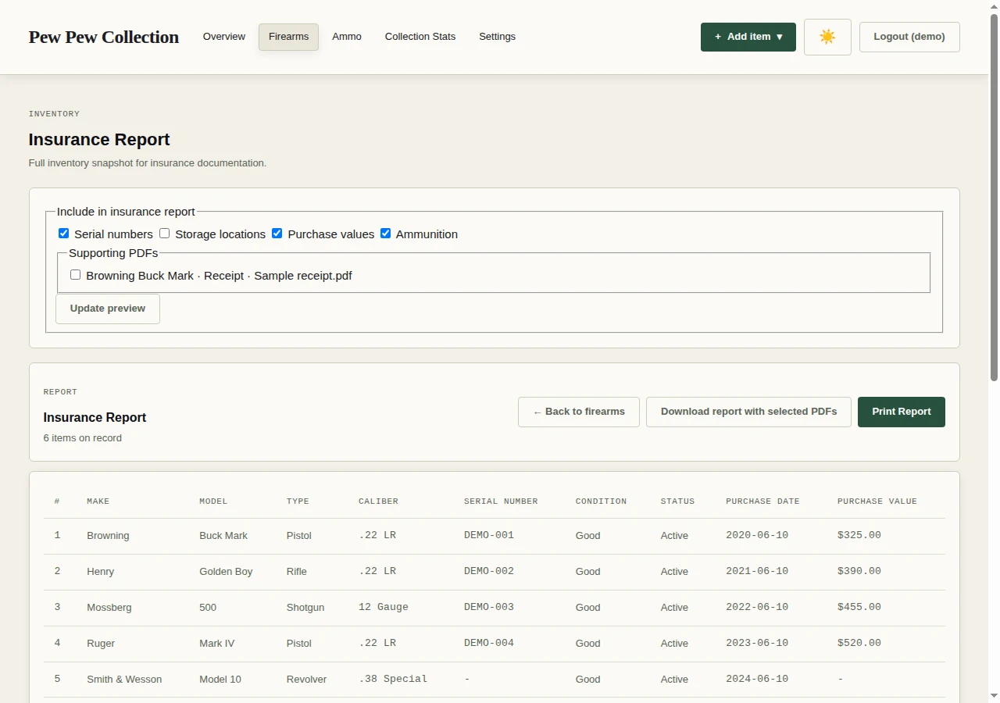

From **Collection Stats**, choose **Preview insurance report**. Select which fields to include and use **Update preview** to check the result. Storage locations are off by default.

Choose **Print Report** for the summary, or tick individual files under **Supporting PDFs** and use **Download report with selected PDFs**. The downloaded HTML opens offline and contains the selected PDFs.

## Settings

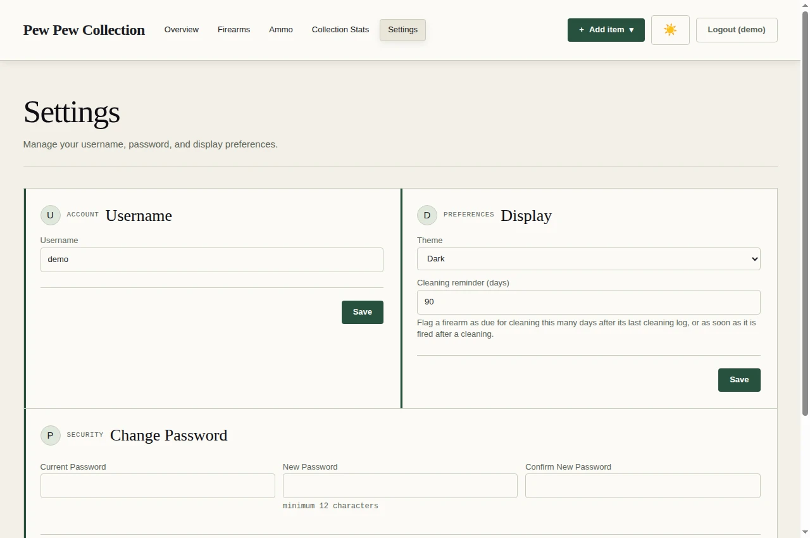

Username, password change, theme toggle, and update-check preference.
